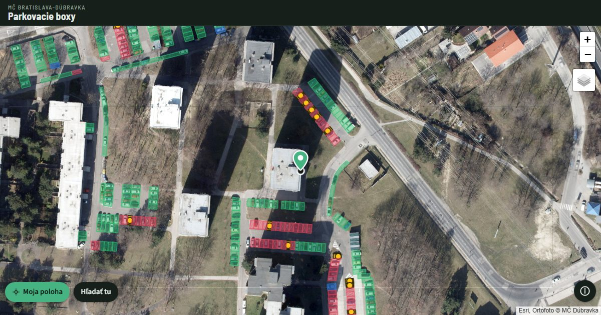

# Parkovacie boxy Dúbravka

An unofficial phone map that shows which reserved parking spaces in Bratislava-Dúbravka are actually rented.

**[Open the map](https://jaro-brutenic.github.io/parkovaniedubravka/)** · About: [Slovensky](https://jaro-brutenic.github.io/parkovaniedubravka/o-aplikacii/) · [English](https://jaro-brutenic.github.io/parkovaniedubravka/about/)



## Why

Many parking spaces in Dúbravka keep their white cross and licence plate sign long after the rental has ended. The district publishes which spaces are rented, but only in a general-purpose GIS map. This page answers one question on the spot: is this space still reserved?

## How it works

- Opens on Dúbravka. With location access, it centres on you and loads every space within 200 m.
- Tap a space to see its record: type, car park, space number and last update.
- Runs entirely in the browser and queries the district's public ArcGIS services directly. No backend, no build step, no tracking.

| Colour | Meaning |
|---|---|
| 🔴 Red | Reserved, with a registered tenant |
| 🟡 Yellow | Reserved, no tenant on record |
| 🟢 Green | Public space; any cross or plate sign is a leftover |
| 🔵 Blue | For holders of a disabled parking card |

A "reserved parking" road sign is legally binding while it stands, whatever the map says.

## Data

- Parking spaces and unrented reserved spaces: public feature services of MČ Bratislava-Dúbravka, the same data as the official [Doprava a parkovanie map](https://experience.arcgis.com/experience/76efb37084c94cdebe96223008a90522).
- Base maps: orthophoto 2026 © MČ Bratislava-Dúbravka, Esri World Imagery around it, and an OpenStreetMap street map you can switch to.

The data covers Dúbravka only. If your district publishes similar parking data, [open an issue](https://github.com/jaro-brutenic/parkovaniedubravka/issues).

## Run locally

It's a static site, so any static file server works:

```bash
python -m http.server 8765
```

Then open http://localhost:8765. Location only works over `https://` or on `localhost`.

## Files

| Path | Purpose |
|---|---|
| `index.html` | The app: HTML, CSS and JS in one file, [Leaflet](https://leafletjs.com) 1.9.4 from cdnjs |
| `o-aplikacii/`, `about/`, `page.css` | About pages in Slovak and English, for search engines and link previews |
| `robots.txt`, `sitemap.xml`, `og.jpg`, favicons | Search and sharing metadata |
| `CNAME` | Custom domain for GitHub Pages |

Deployed with GitHub Pages from the root of `main`.

## License

Code: [MIT](LICENSE). Data and orthophoto © MČ Bratislava-Dúbravka. Made by [Jaroslav Brutenic](https://www.linkedin.com/in/jaroslavbrutenic/); not affiliated with the district office.
